<div align="center">

<!-- The hero is the portfolio's 3D room, projected and baked to SVG so it can
     move inside a README — GitHub strips script, canvas and iframes, but it does
     render an animated SVG. Regenerate with: node scripts/build-banner-3d.mjs -->
<picture>
  <source media="(prefers-color-scheme: light)" srcset="./assets/banner-3d-light.svg" />
  
</picture>

<!-- animated typing -->


<br/>

<!-- social badges -->

<a href="https://github.com/paybackretr0"></a>
<a href="https://www.linkedin.com/in/khaliedmtrn"></a>
<a href="https://www.instagram.com/khaliedmtrn"></a>
<a href="mailto:khalidmaturino@gmail.com"></a>
<a href="https://khalied.maturino.id/"></a>

</div>

<br/>

```text
╭──────────────────────────────────────────────────────────────╮
│  KHALIED NAULY MATURINO                                      │
│  Software developer — mobile & web · information systems     │
│  Padang, Indonesia · Universitas Andalas · GPA 3.77 / 4.00   │
│  Now: Developer & Programmer — PT Persero Batam              │
│  Open to internships · collaborations · interesting builds   │
╰──────────────────────────────────────────────────────────────╯
```

---

## 01 · About me

- 🎓 **Final-year S1 Information Systems** at **Universitas Andalas** — GPA **3.77 / 4.00**, graduating **Sept 2026**.
- 💻 Software developer building **mobile apps (Android · Flutter)** and **web information systems (Laravel · React)**.
- 🏛️ Hands-on experience shipping **campus & government digitalisation** — DPMPTSP Padang, IT Directorate UNAND, PT Persero Batam.
- 🏆 Hackathon medalist — **2nd Place Impact National Hackathon**, **3rd Place National Cybertech Hackathon**, **Gold Medal — Mahasiswa Berdampak Seminar**.
- 🎓 **Bangkit Academy 2024** alumnus (Google-backed Android programme).
- 🚀 Published a production Android app on the **Google Play Store** — _ExcaMotion_.
- ⚙️ Currently levelling up: **clean architecture**, **system design**, **DevOps**.

---

## 02 · The 3D stage

The banner at the top is a **real perspective render** of the room that greets you on the portfolio: one shaft of light, dust in the air, a pool of it on the floor, and a camera that drifts with a single slow sine. It is baked frame by frame from 3D geometry into an SVG — GitHub will not run WebGL in a README, so the geometry is projected on the server side instead of in your browser.

The live version is actual WebGL, and you can walk into it:

<div align="center">

<a href="https://paybackretr0.github.io/en/">
  
</a>

**[Walk into the room ↗](https://paybackretr0.github.io/en/)** · [khalied.maturino.id](https://khalied.maturino.id/en/)

</div>

---

## 03 · Toolbox

<div align="center">

**Languages**


**Frontend**


**Backend**


**Mobile**


**Database & DevOps**


**Tools**


</div>

> 📌 _Also working with: Jetpack Compose · Room · Ant Design · Sequelize ORM · RESTful API · MVC / MVVM / Clean Architecture_

---

## 04 · Pulse

<div align="center">


<br/>


<br/>


<br/>


<!-- Cadangan jika trophy di atas mati (pilih salah satu):
  https://trophy.benkou.dev/?username=paybackretr0&theme=onestar&no-frame=true&no-bg=true&margin-w=6&margin-h=6&column=7
  https://github-trophies.devomb.com/?username=paybackretr0&theme=onestar&no-frame=true&no-bg=true&margin-w=6&margin-h=6&column=7
  https://github-profile-trophy-unserori.vercel.app/?username=paybackretr0&theme=onestar&no-frame=true&no-bg=true&margin-w=6&margin-h=6&column=7
  https://github-profile-trophy-orcin-eta.vercel.app/?username=paybackretr0&theme=onestar&no-frame=true&no-bg=true&margin-w=6&margin-h=6&column=7
-->

</div>

---

## 05 · Contribution

<div align="center">

<!-- Generated daily by .github/workflows/snake.yml -->
<picture>
  <source media="(prefers-color-scheme: dark)" srcset="https://raw.githubusercontent.com/paybackretr0/paybackretr0/output/github-snake-dark.svg" />
  <source media="(prefers-color-scheme: light)" srcset="https://raw.githubusercontent.com/paybackretr0/paybackretr0/output/github-snake.svg" />
  
</picture>

</div>

---

## 06 · Selected work

| Project                                 | Description                                                                                              | Stack                           |
| :-------------------------------------- | :------------------------------------------------------------------------------------------------------- | :------------------------------ |
| **BSS Management System — UNAND**       | Digitalised student temporary-leave flow: online submission, multi-step verification & official letters. | Laravel · MySQL · Docker        |
| **Non-APBN Scholarship System — UNAND** | Scholarship registration, document validation & selection with admin dashboard.                          | React · Express · Redis · MySQL |
| **TeleMetri App + Admin Dashboard**     | Organisation attendance with dynamic QR + geofencing/GPS, plus a web admin portal.                       | Flutter · Laravel · MySQL       |
| **ACEED EXPO Unand 2025**               | Job-fair platform: participant registration, vacancy publication & schedule management.                  | Laravel · MySQL                 |
| **ExcaMotion**                          | Real-time excavator cycle analysis (Dig/Load/Swing/Dump) — **published on Google Play**.                 | Kotlin · Compose · Room         |
| **Whistleblowing DPMPTSP Padang**       | Anonymous complaint reporting with unique tracking code & secure admin–reporter channel.                 | Kotlin · Express · MySQL        |
| **AgroWista**                           | Tourism village app with point-based reviews, QR product scanning & issue reporting.                     | Kotlin · Express · MySQL        |

> 🔭 _Full architecture, database schema & live demos: [khalied.maturino.id → portfolio](https://khalied.maturino.id/en/)_

---

## 07 · Milestones

- 🥇 **Gold Medal — Poster Category**, Seminar Dampak Mahasiswa Berdampak (2026)
- 🥈 **2nd Place — Impact National Hackathon**, Maxy Academy (2024)
- 🥉 **3rd Place — National Cybertech Hackathon**, Politeknik Negeri Padang (2024)
- 🎓 **Bangkit Academy alumnus**, Google · GoTo · Traveloka (2024)
- 🛡️ **Certified Cybersecurity Educator Professional (CCEP)** — Red Team Leaders (2026)
- 🧭 **Leadership**, UKM Neo Telemetri UNAND — OC Coordinator · PIC Firetech 2025 Hackathon · Event Coordinator Open Recruitment 14

---

## 08 · Uplink

I am always open to **internships**, **collaborations** and interesting projects — especially around **campus and public-service digitalisation** and **mobile apps**.

<div align="center">

<a href="https://www.linkedin.com/in/khaliedmtrn"></a>
<a href="https://khalied.maturino.id/en/"></a>
<a href="mailto:khalidmaturino@gmail.com"></a>

<br/><br/>


</div>

---

```text
╭──────────────────────────────────────────────────────────────╮
│  This profile is built like the portfolio: the hero is a     │
│  projected 3D scene, the palette is bone on near-black, and  │
│  the accent is bronze. No framework, no dependencies —       │
│  scripts/build-banner-3d.mjs is plain Node.                  │
│                                                              │
│  "Build systems that make public services work better        │
│   for people."                                               │
╰──────────────────────────────────────────────────────────────╯
```
